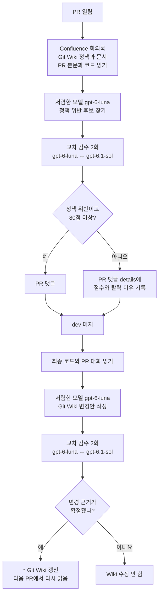

# 정책 기반 PR 검수와 Git Wiki 갱신 설계

## 작업 내용

PR이 팀 정책을 어기는지 자동으로 확인합니다. 일반적인 코드 리뷰나 UX 리뷰가 아니라 **정책 기반 PR 리뷰**입니다.

### 무엇을 리뷰하나요?

리뷰는 Git Wiki에 등록된 정책에서 시작합니다.

```text
Git Wiki에서 현재 적용 중인 정책을 찾음
→ PR 코드가 그 정책과 어긋나는지 확인
→ 어떤 조건에서 문제가 생기는지 확인
→ 사용자에게 어떤 영향이 있는지 확인
→ 두 번 검수하고 점수를 계산
→ 통과한 정책 위반만 PR 댓글로 작성
```

사용자 영향은 새로운 정책을 만드는 기준이 아닙니다. 코드가 정책을 어겼을 때 어떤 결과가 생기는지 설명하고 점수를 매기는 데 사용합니다.

코드가 어색해 보여도 연결된 정책이 없으면 댓글을 남기지 않습니다. 코드 컨벤션이나 아키텍처를 검수하려면 그 규칙을 별도로 등록해야 합니다.

AI가 코드만 보고 정책을 새로 만들지 않도록 입력을 고정했습니다.

- Confluence 회의록: 왜 이런 정책을 정했는지 확인
- Git Wiki: 지금 적용 중인 정책 확인
- PR 본문: 무엇을 바꾸려는지 확인
- 코드 diff: 실제로 바뀐 코드 확인

검수 흐름은 아래와 같습니다.



후보는 아래 기준으로 100점 만점으로 채점합니다.

```text
정책을 실제로 어겼나?       25점
코드에서 근거를 찾았나?     25점
사용자에게 영향이 있나?     20점
다시 재현할 수 있나?        15점
반대 근거를 확인했나?       15점
```

80점 이상이면서 코드 위치와 정책 원문까지 확인된 문제만 PR 댓글로 남깁니다. 탈락한 후보는 같은 PR 댓글의 `사람이 확인할 탈락 후보` `<details>` 안에 점수와 이유를 남깁니다.

```markdown
<details>
<summary>사람이 확인할 탈락 후보</summary>

- `후보 ID` / `정책 ID` / 72/100 / 80점 미만: 탈락한 판단 근거

</details>
```

실행 중에는 `.domain-wiki/output/policy-result.json`에도 모든 후보와 탈락 이유가 저장됩니다. 현재 워크플로는 이 파일을 Artifact로 올리지 않으므로, 실행이 끝난 뒤 계속 확인할 수 있는 기록은 PR 댓글입니다.

### 실제로 어떤 댓글이 달리나요?

[Lab PR #26](https://github.com/korogoo/salmonbus-domain-wiki-lab/pull/26)은 실제 저장소의 [PR #106](https://github.com/woowacourse-teams/2026-salmonbus/pull/106)에서 문제가 남아 있던 중간 커밋을 고정해 검증한 사례입니다.

문제는 아래 순서로 생겼습니다.

```text
1. 예보 A와 차량 A가 함께 화면에 보임
2. 차량 정보 없이 새 예보 B와 C가 1초 간격으로 들어옴
3. 예보를 2개만 저장하는 코드가 기존 예보 A를 삭제함
4. 아직 10초를 기다려야 하지만 화면에서 차량이 바로 사라짐
```

Git Wiki 정책은 `짝이 맞는 차량과 예보만 화면에 보여준다`였습니다. 화면에서 차량이 사라진다는 사실만으로 댓글을 남긴 것이 아닙니다. 코드가 이 정책을 어겼고, 그 결과로 사용자가 차량을 볼 수 없게 된다고 판단했습니다. 이 문제는 두 번의 검수에서 100점을 받아 실제 댓글로 남았습니다.

```markdown
## 확인이 필요한 문제 1건

### 새 예보를 기다리는 도중 차량 표시가 사라집니다

현재는 차량과 함께 표시하던 예보 뒤로 관측 시각이 다른 새 예보가
두 번 도착하면, 기존 예보를 보관 기록에서 삭제합니다.
새 예보에 맞는 차량 정보가 없을 때는 남은 대기 시간을 확인하지 않고
최신 예보로 화면을 바꾸므로 차량 표시도 없어집니다.

**어떤 때 생기나요?**

예보와 차량 정보가 같은 관측 시각으로 표시 중일 때,
각각 10초의 대기 시간이 남은 서로 다른 관측 시각의 새 예보가
1초 간격으로 두 번 도착하고 그에 맞는 차량 정보는 도착하지 않는 경우입니다.

**어떻게 바꾸면 좋을까요?**

새 예보의 대기 기한까지는 마지막으로 함께 표시하던 예보와 차량 정보를
보관 개수 제한과 별도로 유지해 주세요.
새 예보 두 개를 연속 수신한 뒤에도 기한 전에는 기존 쌍이 유지되고,
기한이 지나면 최신 예보만 표시되는지 회귀 테스트를 추가해 주세요.

<details>
<summary>검토 근거</summary>

- 코드: `frontend/src/pages/verdict-board/boardSnapshotPolicy.ts:58`
- 정책: `POL-DSP-001-R2`
- 점수: 100/100
- 항목별 점수: 정책 적용성 25/25, 코드 근거 25/25,
  사용자 영향 20/20, 재현 조건 15/15, 반대 근거 해소 15/15

</details>

<details>
<summary>AI와 로컬 도구용 검증 데이터</summary>

정책 ID, 코드 위치, 점수, 검수 결과를 JSON으로 기록합니다.

</details>
```

사람은 위 설명만 읽으면 됩니다. 로컬 도구나 AI가 댓글을 다시 읽을 때는 `<details>` 안의 JSON을 사용합니다. [실제 댓글 원문](https://github.com/korogoo/salmonbus-domain-wiki-lab/pull/26#issuecomment-6440220511)에는 전체 JSON도 들어 있습니다.

### PR이 머지되면 어떻게 되나요?

PR이 머지되면 최종 코드와 PR 대화를 다시 읽습니다. 그 내용을 바탕으로 Git Wiki 변경안을 만들고 두 번 검수합니다. 변경 근거가 확정됐을 때만 Wiki를 수정합니다.

Confluence 회의록은 결정 근거로만 읽습니다. 자동으로 수정하지 않습니다. 다음 PR부터는 갱신된 Git Wiki를 다시 읽기 때문에, 새 코드도 최신 정책과 문서를 기준으로 검수할 수 있습니다.

실제 저장소 구현은 Confluence에 쓰기 기능을 제공하지 않습니다. PR 검수와 머지 후
Wiki 변경안 모두 `gpt-6-luna`가 초안을 만들고 `gpt-6.1-sol`이 두 번 검수합니다.
머지 후에는 허용 목록에 있는 Wiki 문서의 현재 문장과 바꿀 문장을 정확히 지정하고,
현재 문장이 한 번만 존재할 때만 변경합니다.

구현 코드는 아래 경로에서 확인할 수 있습니다.

- `tools/domain-wiki/domain_wiki/policy_issue_review.py`: 정책 위반 후보, 채점, 2회 검수, PR 댓글
- `tools/domain-wiki/domain_wiki/wiki_update.py`: Wiki 변경 후보, 2회 검수, 확정된 문장 교체
- `tools/domain-wiki/wiki-seed/`: 머지 시 초기화할 AI용 Wiki 문서
- `.github/workflows/domain-policy-review.yml`: PR이 열릴 때 실행하는 정책 검수
- `.github/workflows/domain-wiki-update.yml`: `dev` 머지 뒤 실행하는 Git Wiki 갱신

## 확인 사항

- [x] Lab에서 실제 PR의 중간 커밋을 복사해 정책 위반 후보를 검수했습니다.
- [x] 100점을 받은 후보가 사람용 설명과 AI용 JSON을 포함한 댓글로 작성되는 것을 확인했습니다.
- [x] Lab 도구의 단위 테스트 146개와 GitHub `review`, `test` 검사를 통과했습니다.
- [x] 실제 저장소용 브랜치에서 정책 검수와 Wiki 갱신 단위 테스트 17개를 통과했습니다.
- [x] 80점 미만 후보가 정책 위반 댓글에서 제외되고 탈락 이유로 기록되는지 단위 테스트로 확인했습니다.
- [x] 확정된 변경만 허용된 Git Wiki 문서에 반영되는지 단위 테스트로 확인했습니다.
- [x] 반대 근거가 남은 변경 후보는 Git Wiki를 수정하지 않는지 단위 테스트로 확인했습니다.
- [ ] 실제 저장소에서 PR 댓글 워크플로를 실행하지 않았습니다.
- [ ] 실제 `dev` 머지로 Git Wiki가 갱신되는지는 아직 확인하지 않았습니다.
- [x] 기존 빌드와 배포 흐름에 영향을 주지 않는지 확인했습니다.

## 참고 사항

Lab에서는 실제 Salmonbus PR의 base/head SHA를 복사해 원본 코드를 바꾸지 않고 검수 흐름을 확인했습니다.

- [Lab 정책 검수 예시](https://github.com/korogoo/salmonbus-domain-wiki-lab/pull/26#issuecomment-6440220511)
- [Lab 구현 브랜치](https://github.com/korogoo/salmonbus-domain-wiki-lab/tree/lab/tools/domain-wiki)

실제 저장소에서 AI 검수를 실행하려면 아래 설정이 필요합니다.

- Git Wiki의 정책은 우선 `draft`로 게시합니다. FE·BE 승인 뒤에만 `active`로 바꿉니다.
- `ATLASSIAN_EMAIL`, `ATLASSIAN_API_TOKEN`, `OPENAI_API_KEY`를 저장소 Secret으로 등록합니다.
- 외부 fork의 코드는 실행하지 않고, base 브랜치의 검수 코드만 신뢰해서 실행하는 조건을 유지합니다.

2026-10-28 확인 결과 세 Secret은 아직 등록되지 않았습니다. Secret이 없어도 머지 시
Wiki 기본 문서는 만들 수 있지만, 모델을 호출하는 PR 검수와 머지 문서 검수는 건너뜁니다.

로컬 Backend 전체 빌드는 Colima가 Ryuk의 Docker 소켓 마운트를 지원하지 않아 `TESTCONTAINERS_RYUK_DISABLED=true`로 실행했습니다. 테스트용 PostgreSQL 컨테이너는 그대로 사용했고, 전체 빌드와 배포 패키징, 배포 리허설 169개 검사가 통과했습니다.

실제 구현에서는 정책 검수와 머지 후 Git Wiki 갱신까지 다룹니다. 회의록 자동 수정과 `namukkun` 공유 스킬은 포함하지 않습니다.
